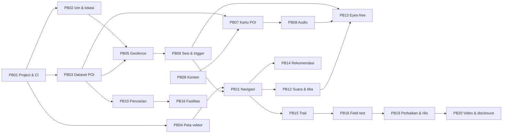

# Implementation Phases — AGAM v1

| Atribut | Nilai |
| --- | --- |
| Status dokumen | Rencana awal; seluruh PBI `planned` |
| Tanggal | 2 November 2026 |
| Kontrak produk | `.agent/PRD.md`; aturan kerja di `.agent/rules.md` |
| Model kerja | 5 sprint × 1 minggu (Week 10–14), deliverable final Week 15 |
| Backlog | PB01–PB20 dari PRD resmi; ID tidak boleh diubah atau dinomori ulang agar tetap dapat ditelusuri ke baseline |
| Current focus | Belum dimulai; implementasi pertama adalah PB01 |

Dokumen ini menetapkan urutan pekerjaan, dependency, deliverable, dan definition of done. Rencana bukan bukti implementasi.

## 1. Status dan Definition of Done

| Status | Makna |
| --- | --- |
| `planned` | Scope dan dependency diketahui; belum dimulai |
| `in_progress` | Sedang dikerjakan |
| `blocked` | Tidak dapat dilanjutkan karena dependency atau keputusan tertentu (dicatat) |
| `deferred` | Ditunda secara eksplisit oleh PM, dengan alasan dan dampak |
| `done` | Deliverable tersedia dan acceptance/done criteria memiliki evidence nyata |

Setiap PBI berstatus `done` wajib memiliki:

- Source/data/konfigurasi yang tercatat.
- Pemeriksaan pada input final (command, cakupan, hasil) sesuai `.agent/rules.md` §6.
- Evidence acceptance; untuk perilaku lokasi, evidence dari perangkat fisik.
- Keterbatasan dan dependency yang belum selesai, tanpa diubah menjadi PASS.
- Pembaruan `.agent/sessionHandoff.md` dan PRD jika ada perubahan material.

## 2. Milestone

| Waktu | Milestone |
| --- | --- |
| Week 9 | PRD baseline disetujui (gate sebelum pengembangan) |
| Week 10 | Sprint 1 |
| Week 11 | Sprint 2 |
| Week 12 | Sprint 3 + **Major Progress Review** |
| Week 13 | Sprint 4 + **Feature Freeze** di akhir minggu |
| Week 14 | Sprint 5: testing acceptance, perbaikan defect, retest |
| Week 15 | Final deliverables: APK, Testing Report, PRD Compliance Matrix, video ≤3 menit, AI & Tools Disclosure |

## 3. Ringkasan Sprint

| Sprint | Sprint goal | PBI | Status |
| --- | --- | --- | --- |
| S1 — Week 10 | Fondasi aplikasi, location awareness, peta | PB01, PB02, PB03, PB04 | `planned` |
| S2 — Week 11 | POI, location logic, trigger, kartu & audio | PB05, PB06, PB07, PB08, PB09 | `planned` |
| S3 — Week 12 | Pencarian dan navigasi; siap Major Progress Review | PB10, PB11, PB12 | `planned` |
| S4 — Week 13 | Fitur utama lengkap dan terintegrasi; Feature Freeze | PB13, PB14, PB15, PB16, PB17 | `planned` |
| S5 — Week 14 | Uji acceptance, perbaikan, rilis v1.0, dokumentasi akhir | PB18, PB19, PB20 | `planned` |

## 4. Sprint 1 — Fondasi Aplikasi dan Location Awareness

### PB01 — Project Flutter, repository, pipeline build APK

- **Requirement:** —
- **Scope:** inisialisasi project Flutter, kunci versi Flutter/Dart, struktur folder, lint, workflow GitHub Actions yang membangun APK dan mengunggahnya ke GitHub Releases.
- **Verifikasi saat setup:** versi Flutter/Dart, minSdk yang didukung, `targetSdk`.
- **Done:** APK debug terpasang dan dibuka tanpa crash di perangkat uji; workflow CI berjalan.
- **Status:** `planned`

### PB02 — Onboarding privasi, izin, dan pembacaan lokasi

- **Requirement:** F01, A01
- **Scope:** layar penjelasan privasi; izin lokasi akurat ("saat aplikasi digunakan") dan notifikasi; penanganan izin perkiraan/ditolak; panduan pengaturan baterai pabrikan; pembacaan lokasi mode **peta biasa** (hanya saat aplikasi tampil di layar).
- **Done:** izin diminta setelah layar penjelasan; lokasi terbaca dan diperbarui; pembacaan berhenti saat aplikasi diminimalkan.
- **Status:** `planned`

### PB03 — Dataset 10 POI (Firestore + JSON bawaan)

- **Requirement:** F01, F02, F05, A02
- **Scope:** finalisasi skema (PRD §15.3); JSON bawaan berisi 10 POI dari PRD §9.1 (koordinat, radius 15 m, kategori, alias); repository data dengan sinkronisasi Firestore → cache lokal; validasi dokumen; fallback ke salinan lokal.
- **Dependency eksternal:** project Firebase (belum dibuat). Tanpa Firebase, bagian JSON bawaan dan validasi tetap dapat dikerjakan; bagian Firestore `blocked`.
- **Done:** data 10 POI terbaca dari server dan dari cache lokal; dokumen tidak valid diabaikan; aplikasi berjalan saat offline.
- **Status:** `planned`

### PB04 — Explore Map dengan tile vektor dibundel

- **Requirement:** F01, A03
- **Scope:** script pipeline tile (data OSM → PMTiles, area kampus + ±200 m); file style AGAM; renderer di Flutter; penanda 10 POI; posisi pengguna real-time; batas area kampus dan pesan di luar area; atribusi OSM.
- **Done:** peta tampil offline sejak instalasi; 10 POI dan posisi pengguna yang bergerak terlihat; script tile dapat dijalankan ulang; ukuran tile tercatat.
- **Status:** `planned`

## 5. Sprint 2 — POI, Location Logic, dan Trigger

### PB05 — Engine geofence in-app

- **Requirement:** F02
- **Scope:** haversine, dwell ≥5 detik, cooldown 10 menit, histeresis, filter akurasi >20 m, interval adaptif (±10 detik bila diam atau >200 m dari POI).
- **Done:** unit test lulus dengan nilai independen; trigger tepat pada POI uji.
- **Status:** `planned`

### PB06 — Sesi lokasi, notifikasi, getar, dan prompt saat trigger

- **Requirement:** F02, F04, A01
- **Scope:** mode Explore/Navigasi/Trail sebagai sesi; foreground service tipe `location` dengan notifikasi tetap; trigger saat layar mati; tombol Akhiri; auto-end 30 menit di luar area; respons trigger per mode (PRD §9.2); prompt audio per POI.
- **Done:** notifikasi dan prompt muncul ≤10 detik setelah masuk radius, termasuk saat layar mati di perangkat fisik; tidak ada pembacaan lokasi di luar sesi kecuali mode peta biasa di layar.
- **Status:** `planned`

### PB07 — Kartu POI

- **Requirement:** F03
- **Scope:** foto, fungsi, fasilitas, trivia, sumber (A02); pemutar video untuk GKUB/GKUT; dibuka dari trigger maupun dari peta.
- **Done:** kartu terbuka dari trigger dan dari peta dengan konten sesuai.
- **Status:** `planned`

### PB08 — Pemutar narasi audio

- **Requirement:** F03, F04
- **Scope:** play/pause/ulang di kartu; kontrol dari notifikasi dan lock screen; opsi auto-play.
- **Done:** narasi dapat dikendalikan dari kartu dan notifikasi.
- **Status:** `planned`

### PB09 — Produksi konten 10 POI (tim konten)

- **Requirement:** F03, A02
- **Scope:** teks, foto, naskah dan file narasi 45–90 detik, prompt trigger dan pengumuman tiba per POI, video GKUB/GKUT, metadata sumber dan atribusi.
- **Catatan:** agent dilarang membuat konten ini; agent hanya menyiapkan format dan validasinya.
- **Done:** konten 10 POI lengkap, sumber tercatat, hak penggunaan media aman, disetujui tim.
- **Status:** `planned`

## 6. Sprint 3 — Pencarian dan Navigasi

### PB10 — Pencarian dengan alias dan filter kategori

- **Requirement:** F05
- **Scope:** normalisasi teks, konversi angka Arab ↔ Romawi, alias/singkatan, filter kategori, pencarian lokal.
- **Done:** "labtek 5", "Labtek V", "lab 5" → Labtek V teratas; respons ≤1 detik.
- **Status:** `planned`

### PB11 — Navigasi jalan kaki di perangkat

- **Requirement:** F06, A01
- **Scope:** graf jalur kampus (GeoJSON dari OSM + koreksi survei); Dijkstra/A* di perangkat; garis rute, jarak, ETA; rerouting bila menyimpang >25 m; mengaktifkan sesi Navigasi.
- **Dependency eksternal:** koordinat pintu masuk (survei). Sebelum tersedia, titik tengah gedung dipakai sebagai placeholder berlabel.
- **Done:** rute tampil ke pintu masuk tujuan; rerouting berjalan; tidak ada request routing ke server.
- **Status:** `planned`

### PB12 — Arahan suara navigasi dan deteksi tiba

- **Requirement:** F04, F06
- **Scope:** TTS runtime `id-ID` untuk arahan belokan; fallback visual bila suara tidak tersedia; deteksi tiba ≤15 m dengan audio pengumuman tiba.
- **Done:** arahan suara di setiap belokan; pengumuman tiba saat ≤15 m dari tujuan.
- **Status:** `planned`

## 7. Sprint 4 — Fitur Utama dan Feature Freeze

### PB13 — Mode eyes-free

- **Requirement:** F04
- **Scope:** tombol besar, auto-play opsional, kontrol dari notifikasi, alur tanpa membaca layar.
- **Done:** alur trigger, narasi, dan navigasi dapat dijalankan tanpa membaca layar.
- **Status:** `planned`

### PB14 — Rekomendasi POI berikutnya

- **Requirement:** F07
- **Scope:** 1–3 POI berdasarkan jarak, status belum dikunjungi, dan urutan trail; fasilitas terdekat; navigasi satu ketukan.
- **Done:** rekomendasi muncul setelah kartu ditutup/tiba dan dapat langsung dinavigasikan.
- **Status:** `planned`

### PB15 — Orientation Trail

- **Requirement:** F08
- **Scope:** urutan trail, navigasi berantai, check-in otomatis (termasuk di luar urutan), progres x/10 tersimpan lokal, lencana.
- **Dependency eksternal:** urutan trail dari tim.
- **Done:** progres tersimpan setelah aplikasi ditutup; lencana muncul saat 10/10.
- **Status:** `planned`

### PB16 — Fasilitas terdekat

- **Requirement:** F05, F07
- **Scope:** daftar fasilitas per kategori, terurut menurut jarak, dapat dinavigasikan.
- **Dependency eksternal:** dataset fasilitas dari tim konten.
- **Prioritas:** Should
- **Status:** `planned`

### PB17 — Verifikasi akses offline

- **Requirement:** A03
- **Scope:** tile peta sudah dibundel sejak PB04; PBI ini memastikan kartu, metadata, media, trigger, navigasi, dan progres berfungsi tanpa jaringan, serta menampilkan keadaan yang jelas untuk komponen yang tidak tersedia.
- **Prioritas:** Could
- **Done:** trigger dan kartu POI berfungsi dalam mode pesawat tanpa crash.
- **Status:** `planned`

## 8. Sprint 5 — Pengujian, Rilis, dan Dokumentasi

### PB18 — Field testing dan usability testing

- **Requirement:** F01–F08
- **Scope:** uji di Kampus Ganesha di beberapa perangkat (termasuk merek dengan optimasi baterai agresif); skenario F02 (≥8/10 POI), F04 (≥3 penguji), F06 (≥4/5 tujuan acak).
- **Done:** laporan uji dan daftar defect tercatat.
- **Status:** `planned`

### PB19 — Perbaikan defect, kalibrasi, retest, rilis v1.0

- **Requirement:** F01–F08
- **Scope:** perbaikan defect prioritas tinggi, kalibrasi radius dan histeresis per POI (dicatat di PRD), retest, rilis APK v1.0 di GitHub Releases.
- **Done:** defect prioritas tinggi selesai; APK v1.0 lulus retest acceptance criteria.
- **Status:** `planned`

### PB20 — Video showcase dan AI & Tools Disclosure

- **Requirement:** —
- **Scope:** video produk ≤3 menit di YouTube; dokumen disclosure penggunaan AI dan tools.
- **Done:** video terunggah sesuai format; dokumen disclosure lengkap.
- **Status:** `planned`

## 9. Requirement Coverage

| Requirement | PBI | Evidence akhir |
| --- | --- | --- |
| F01 Location Awareness | PB02, PB04 | Live demo + video test |
| F02 Location-Based Trigger | PB05, PB06, PB19 | Video field test + log (≥8/10 POI) |
| F03 Multimodal Exploration | PB07, PB08, PB09 | Pemeriksaan 10 kartu POI |
| F04 Eyes-Free Interaction | PB06, PB08, PB12, PB13 | Uji ≥3 penguji |
| F05 Search & Destination | PB03, PB10, PB16 | Test pencarian + pengukuran waktu respons |
| F06 Navigation | PB11, PB12 | Field test ≥4/5 tujuan acak |
| F07 Contextual Recommendation | PB14, PB16 | Demo alur kartu ditutup/tiba |
| F08 Orientation Trail | PB15 | Demo progres tersimpan + lencana |
| A01 Privacy & Session Control | PB02, PB06, PB11 | Pemeriksaan penyimpanan dan lalu lintas jaringan |
| A02 Content Traceability | PB03, PB07, PB09 | Metadata lengkap pada 10 POI |
| A03 Offline Information Access | PB03, PB04, PB17 | Uji mode pesawat |

## 10. Dependency Eksternal

| Dependency | Dibutuhkan oleh | Status |
| --- | --- | --- |
| Project Firebase | PB03 | Belum dibuat |
| Konten P01–P10 (teks, foto, audio, video, metadata) | PB07, PB08, PB09 | Belum tersedia |
| Koordinat pintu masuk | PB11, PB12 | Menunggu survei |
| Urutan Orientation Trail | PB15 | Belum ditetapkan |
| Dataset fasilitas | PB16 | Akan dikumpulkan |
| Perangkat uji Android | PB02, PB06, PB18 | Belum ditetapkan |

Jika dependency belum tersedia, kerjakan bagian yang independen, gunakan placeholder berlabel, dan catat status `blocked` untuk bagian yang bergantung padanya.

## 11. Pencatatan Progres

Saat status PBI berubah, perbarui tabel §3, status di bagian PBI terkait, dan `.agent/sessionHandoff.md`. Untuk Major Progress Review Week 12, laporkan: sprint goal, PBI yang direncanakan, selesai, dan belum selesai, evidence, blocker, serta rencana tindak lanjut.
